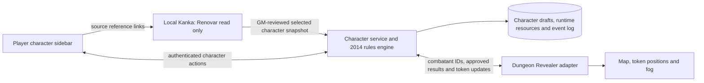

# 2014 5e character layer for Kanka and Dungeon Revealer

Assessment: 2026-11-06. No additional application or dependency was installed. Existing demos and Kanka data are unchanged.

**Current direction:** the [quest-driven Kanka–OCF–DR plan](kanka-ocf-dungeon-revealer-plan.md) puts source preparation in Kanka: structured sheets and a quest linking the map/participants. A small OCF launcher accepts the quest URL, reads the API, validates the inputs and launches DR. Kanka holds editable sheet data; the handler stores runtime state/history and supports reviewed refreshes. The comparison below is supporting research; the revised plan supersedes its earlier architectural alternatives.

## Recommendation

Evaluate **Open Character Format (OCF)** first when the goal is reusable code behind a custom character sidebar. Evaluate **DiceCloud** first when the goal is a complete separately hosted character manager. Neither supplies an existing Kanka-to-Dungeon-Revealer connector.

The two choices solve different problems: an engine helps implement generation and calculations inside our own experience; a complete manager supplies a character-editing application but adds another login, storage system and integration boundary.

Local Renovar remains the read-only test source. Keep campaign 1 as the clean SRD reference. Store imported character drafts, review overrides and combat state outside both source campaigns. Creating a character in the new layer does not create a Kanka entry automatically.

## Candidates

| Candidate | What it supplies | Fit and remaining work |
| --- | --- | --- |
| **[Open Character Format](https://github.com/pixelqueue/opencharacter)** | TypeScript engine, portable character format, choices/changes/actions and a separate SRD 5.1 rules pack | Best code-level candidate. We still build the sidebar, storage, accounts, import review and VTT adapter. Apache-2.0 engine; CC-BY-4.0 SRD pack. |
| **[DiceCloud](https://github.com/ThaumRystra/DiceCloud)** | Full real-time character manager with derived calculations and configurable character properties/libraries | Strong standalone option, with Meteor/MongoDB deployment. REST export exists; Kanka ingestion and action integration still need work. Inspected license is GPLv3. |
| **[Dungeon Master's Vault Community Edition](https://github.com/Orcpub/orcpub)** | Full 5e character creation and management application | Worth considering if a guided builder is the main requirement. Clojure/ClojureScript and Datomic add a substantial separate stack; not a small TypeScript library. EPL-2.0. |
| **[Charnik](https://github.com/FernDragonborn/charnik)** | 2014/2024 building, leveling and play tracking, with separate content data | MIT code is attractive for reuse, but its current Tauri/SvelteKit app is desktop-oriented and has no HTTP server. Multiplayer service extraction and React integration remain work. |
| **[CSheet](https://github.com/igor47/csheet)** | Hosted character management with SRD 5.1/5.2, scores, skills, levels, HP and spell resources | Relevant manager design, but not a dice/combat engine. Bun/Hono/PostgreSQL stack. Its actual current license is FSL-1.1-MIT, not unrestricted MIT. |

These are source/documentation assessments, not runtime acceptance tests of the managers.

## Open Character Format: preferred library spike

The inspected public packages are `@opencharacter/engine` and `@opencharacter/5e-srd-5.1`, both at **0.4.0**. npm reported that version published on **2026-11-02**. Pin both versions and the character schema: this is a recently published version, not evidence of production maturity.

The library exposes sheet calculation and action/change APIs; its SRD pack documents guided/random creation, leveling, attacks, casting and rests. That supports the proposed use better than extracting a complete application's UI and database. Its documentation also lists substantial manual or application-owned behavior, including turn economy, positioning and many feature/spell effects. Claims about coverage must be verified against fixtures before relying on them. [Engine source](https://github.com/pixelqueue/opencharacter/tree/main/packages/engine), [SRD 5.1 pack and limitations](https://github.com/pixelqueue/opencharacter/tree/main/packs/5e/srd-5.1).

The published engine requires **Node 22 or later**, while the existing Dungeon Revealer image uses Node 16. Do not install the engine into that image and assume compatibility. Start with a separate modern Node character service and bundle the client UI using an appropriate modern build environment. Upgrading Dungeon Revealer's backend is a separate compatibility project; the current OCF monorepo's own development tooling also has newer requirements than the published package.

Use only the SRD 5.1 pack for this pilot. Connect actions to canonical Kanka reference IDs, retaining Kanka as the place to read full rules and lore. Do not silently mix in the 2024 pack or build another broad compendium UI.

Lux is a useful compatibility test precisely because some recorded race/features/feats extend beyond the SRD. Preserve reviewed source statistics and explicit unsupported actions. Do not replace the character with the closest SRD race or older ranger features merely to satisfy the engine. Test one purely SRD character alongside Lux to separate adapter failures from unsupported content.

## DiceCloud: preferred complete-manager trial

DiceCloud already offers the character-editing workflow and derived-property approach that we would otherwise build. Its repository includes a self-hosting Compose example. Treat that as a starting point, replacing floating images and example credentials before any deployment. [Upstream Compose](https://github.com/ThaumRystra/DiceCloud/blob/master/docker-compose.yml).

The inspected REST source provides token login and **GET `/api/creature/:id`**, including creature properties and computed variables with a schema version. This is useful for publishing a character's calculated combat profile. It is not proof of a complete stable CRUD/action API: imports, player grants and resource-consuming actions need a separate interface review. [Creature export](https://github.com/ThaumRystra/DiceCloud/blob/master/app/imports/server/rest/apiPublications/creature.js), [REST login](https://github.com/ThaumRystra/DiceCloud/blob/master/app/imports/server/rest/restLogin.js).

Its additional application and MongoDB are reasonable if players want a full manager alongside the map. They are harder to justify if the desired product is simply a compact sidebar inside Dungeon Revealer. Keep a DiceCloud fork/service separate from Kanka and retain its own license notices. No existing user or Kanka owner credential should be exposed to player clients.

## Other tradeoffs

Dungeon Master's Vault is a credible full-builder alternative, but reuse means operating or adapting a separate Clojure application. Its content import format is not our normalized combat profile, so it still needs an adapter. Its `.orcbrew` workflow concerns custom content and should not be assumed to import arbitrary Kanka characters. [Project architecture](https://github.com/Orcpub/orcpub), [content import documentation](https://www.dungeonmastersvault.com/help/known-issues-site-limitations/).

Charnik separates engine/UI concerns and rules content, which may make selected algorithms or schema ideas useful. Its desktop filesystem and Tauri interfaces cannot serve as shared campaign storage without changes. Confirm the boundaries of its pure TypeScript modules before promising direct reuse. [Architecture and setup](https://github.com/FernDragonborn/charnik).

CSheet's README calls it open source, but the inspected license grants permitted uses subject to a competing-commercial-use restriction and identifies FSL-1.1-MIT. Do not list it as an MIT library or copy code on that assumption. It is also explicitly a sheet manager rather than a dice simulator. [Actual license](https://github.com/igor47/csheet/blob/main/LICENSE.md), [project scope](https://github.com/igor47/csheet).

## Proposed integration boundary

Give the manager one clear authority: it owns the reviewed mechanical profile, current HP/temp HP, slots, uses, conditions and durable action history. Dungeon Revealer owns map placement and fog. A token refers to a combatant ID; it does not contain an independent editable copy of all resources. Kanka remains the read-only source for this test.

The sidebar can be a React panel in a Dungeon Revealer fork or initially a separate companion view. A separate view proves the data and action flow sooner; it does not satisfy the final embedded-sidebar requirement. An iframe alone would not establish identity or synchronized state.

All roll buttons submit action IDs and approved inputs to the character service. The service validates control, resolves the action, commits resource changes and a persistent event, and returns a player-safe result card. Dungeon Revealer may display that result, but must not roll the same action again. Existing native dice chat can remain available for explicitly separate ad hoc rolls. Its in-memory history is not the permanent record.

No candidate fixes Dungeon Revealer's shared-password and token-control model automatically. Individual character assignment needs authenticated player identities bound securely to VTT sessions and server-side checks in the native token/action paths. Otherwise another holder of the player password could bypass a protected sidebar. That work remains part of the integration estimate whichever character package is chosen.

## First proof and decision gate

Time-box **4–8 engineering hours** to evaluating the published OCF packages, not to finishing the integration:

1. Pin package/schema versions and load only SRD 5.1 in an isolated service.
2. Map a reviewed read-only Lux snapshot and one synthetic SRD character into the format; surface unsupported content and missing fields.
3. Check representative scores, proficiency, AC, HP, initiative and a weapon attack against the reviewed input. Confirm that source overrides are not double-counted or overwritten.
4. Render a small sidebar with one attack and one limited resource. Resolve actions server-side and demonstrate a durable result card.
5. Link one existing Dungeon Revealer token, checking that a retry neither rerolls nor spends twice. Explicitly list the remaining identity/permission work rather than implying native shared passwords provide ownership.

Proceed only if the engine handles the supported mechanics cleanly and permits explicit campaign overrides. Otherwise trial DiceCloud as a separate manager before writing a bespoke general-purpose builder. Do not claim the previous combat integration estimate is reduced until one end-to-end adapter is measured.

See the [combat contract and acceptance criteria](planarally-combat-integration-plan.md), [VTT comparison](vtt-combat-fit-assessment.md), and [Dungeon Revealer demo](dungeon-revealer-demo.md). This document evaluates an alternative character-service architecture; it does not silently replace the existing PlanarAlly implementation proposal or authorize combat writeback into Renovar.
