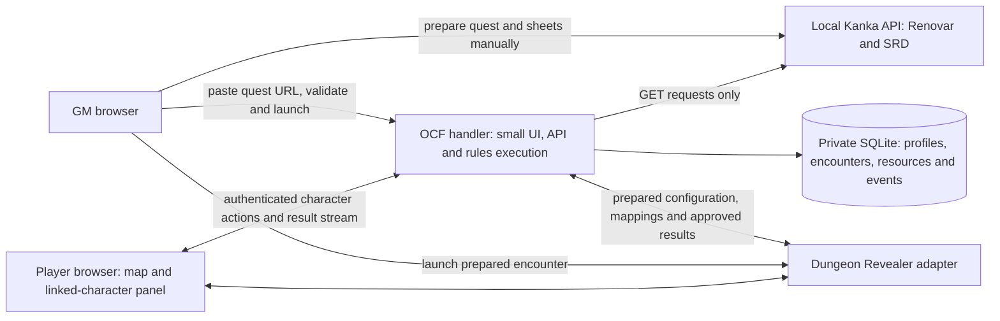

# Read-only Kanka, OCF encounter handler and Dungeon Revealer

Historical architecture plan. See [current DR/OCF operations](ocf-dr-integration-demo.md) for implemented behavior and remaining limitations.

Status: basic quest-driven implementation running, 2026-11-06. This document also describes later features beyond the basic demo. The independent PlanarAlly comparison remains available.

**Implementation update:** the [basic OCF/DR demo](ocf-dr-integration-demo.md) is now running. It reads one **OCF Combat Sheet v1** attribute per participant, prepares the selected test quest, launches DR into the correct map and adds a stats/attack popup with persistent server rolls. The broader plan below includes deferred work such as individual player grants, staged refresh review and richer mechanics; it is not a claim that those features are implemented.

The selected pilot is [local Test Quest, entity 3536](ocf-test-quest.md), with Lux, Black Bear and the explicitly selected Renovar world map. A private normalized data fixture is prepared. The quest currently uses inline mentions rather than typed Quest Elements and has no map link; the pilot compatibility path must show these limitations rather than claim a complete structured import.

**First implementation round:** basic HP/AC, ability scores/modifiers, movement, initiative and basic weapon/natural attack rolls only. Spells, special-feature actions, limited-use resources, condition automation and automated multiattack are deferred. Use the selected pilot's basic-only fixtures, preserve recorded total bonuses, and confirm starting HP. The broader sections and effort estimates below describe the later full pilot, not the narrowed first-round deliverable.

## Ownership and scope

**The handler's Kanka API access stays read-only.** The GM authors resources and structured character-sheet data in Kanka, then creates a quest linking the map, characters and creatures for the encounter. The OCF handler accepts that quest's URL, loads and validates the linked resources through the API, and prepares the configuration that Dungeon Revealer opens. The GM can edit Kanka manually; read-only describes the integration's access, not a prohibition on source authoring.

| Component | Owns |
| --- | --- |
| Local Kanka | GM-authored character/creature sheets, equipment and abilities, quest participant/map links, artwork, rules and lore |
| OCF handler | Validated source snapshots, compiled OCF profiles, player assignments, encounter preparation, runtime HP/resources/effects, roll history and mappings |
| Dungeon Revealer | Map display, fog, token positions and a compact linked-character panel with permitted action buttons |

Read **local Renovar, campaign 2**, for the pilot and use **campaign 1, SRD 5.1**, as an optional read-only reference/template source. No campaign copy or new Kanka category is needed. The handler creates or changes no Kanka records, properties, attachments, relationships, inventory or tags. Campaign 1 stays a clean reference. No hosted Kanka API is contacted. Preparing new source quests/sheets in Renovar is a separate explicit GM authoring step; this planning task has changed no campaign data.

The OCF handler is our application built around the OCF engine, not a ready-made OCF server. Its small interface handles quest loading, validation, player assignment, refresh and launch. It requires authentication, persistence and a Dungeon Revealer adapter, but no campaign browser, general character editor or encounter builder. Use the previously inspected `@opencharacter/engine` and `@opencharacter/5e-srd-5.1` packages as initial pinned candidates, subject to compatibility tests. Keep the ruleset on 2014 5e / SRD 5.1.

## GM workflow

1. In Kanka, prepare the character/creature resources and attach their structured combat sheets. Set equipped inventory and relevant action/ability references. Add the map and participants as linked Quest Elements with the agreed roles. Use optional encounter settings for repeated enemies and initial placement.
2. Open the **OCF Quest Launcher**, sign in, and paste the Kanka quest URL. The handler verifies the configured installation/campaign, resolves the quest entity and its native child ID, then reads the quest elements and selected resources. It does not scrape the rendered page or crawl narrative links.
3. Review one readiness screen listing the map, participants/counts, ready actions, missing fields and unsupported mechanics. Correct source-sheet problems in Kanka and click **Reload**. Unsupported abilities can remain explicit manual/reference actions; the handler must not invent their mechanics.
4. Assign PCs to named player accounts if not already assigned. Keep map/roster authoring in Kanka and runtime positioning/fog in DR. Show the validated starting configuration before preparing it.
5. Click **Prepare and Open in Dungeon Revealer**. The handler creates or updates the dedicated DR map/scene and selected token assets, then launches that exact encounter. Player invitations open their permitted character links/actions.
6. After editing a character, sheet, equipment selection or quest in Kanka, click **Refresh from Kanka** in OCF. Review and apply the changes to the prepared or running encounter while preserving runtime state.

Refreshing a Kanka source is a manual, reviewed operation. Compare the previous source snapshot, the new source data and the current encounter state. Source changes do not silently overwrite an active session ruling, refill resources or reset an encounter. Changes to maximum HP, resource limits or available actions need explicit reconciliation. Quest roster changes add/remove participants only after review; do not silently delete an active combatant. A source entry disappearing or becoming inaccessible blocks new imports/refreshes; previously approved snapshots remain marked with their import time. Recheck grants before sharing a newly refreshed profile.

See the [quest and sheet input format](kanka-encounter-input-format.md): role-linked Quest Elements identify the map and roster, the single **OCF Combat Sheet v1** attribute carries each participant's structured mechanics, and an optional future `encounter.v1.json` sets counts/placement. A Kanka biography or arbitrary JSON is not automatically an OCF character file.

The initial OCF interface needs only **Quest URL**, **Load/Reload**, a readiness/diff preview, **Player assignments**, **Prepare/Open**, and **Refresh from Kanka**. Complete sheet editing, resource search and character generation are outside this first interface.

## What appears in Dungeon Revealer

Keep Dungeon Revealer focused on the tabletop. Selecting a token shows a compact linked-character panel:

- Character name, source link and a button to open its full OCF sheet.
- HP/temp HP, AC, speed, initiative and current effects, filtered by the viewer's permissions.
- Ability checks, saves and skills with approved roll buttons.
- Equipped weapons and their attack/damage choices.
- Relevant prepared abilities/spells and remaining resources.
- Equipped inventory; the full inventory remains in the handler/Kanka source view.

Character authoring, leveling/build changes, prepared equipment/actions and quest composition are managed in Kanka before loading or refreshing OCF. The handler provides validation and runtime adjudication rather than a second full sheet editor. Full lore and rules reading opens Kanka. The compact DR panel sends action requests to the handler and displays returned results; it does not maintain another editable character sheet or independently recalculate those actions.

## Deployment

Add **one OCF handler container** with a modern Node runtime compatible with the published engine, initially Node 24 subject to build verification. Serve the GM UI, API and real-time updates from that container. Use SQLite on a persistent private volume for the initial small-group deployment; no additional database or bridge daemon is needed.

Keep Dungeon Revealer in its existing separate container, with a small maintained adapter/fork for encounter launch, character links, player-session binding and compact action display. Its current Node 16 runtime must not be assumed capable of running the new OCF package. Put rules execution in the modern handler instead of upgrading the entire legacy VTT as part of this work.

Preserve Kanka and DR Compose projects. Connect only the handler and required application services through a dedicated integration network; do not share Kanka's database or give the handler SQL access. Publish the handler on a separate loopback port, provisionally **18084**, after checking availability. Keep DR on **18083** and Kanka on **18081**. LAN/VPN origins and allowed browser origins must be explicitly configured before remote play.

Configure Kanka credentials only in the handler's private server configuration. Use a dedicated identity with view-only access to the selected campaign content wherever Kanka's permission model permits. Additionally constrain the adapter to approved source installations/campaigns and GET endpoints. Do not send PATs to browser clients or DR, accept arbitrary source URLs, or include credentials in launch links. Read permissions must cover required child records; otherwise report the missing data for GM review.

The handler's SQLite data, selected cached assets and integration mappings are durable. Its profile projections, pairing state and action requests are versioned. Preserve Apache-2.0 engine notices, SRD attribution, Dungeon Revealer's ISC notices and existing artwork provenance. Private Renovar snapshots/artwork never enter public repositories or built images.

## Data in the handler

| Record | Purpose |
| --- | --- |
| Source mapping | Installation UUID, quest campaign/entity/child IDs, quest-element IDs, participant entity IDs, source attachment IDs and content hashes |
| Mechanical profile cache | Validated Kanka sheet, compiled versioned OCF data, pinned schema/pack versions and approved equipment/actions |
| Review provenance | Original imported fields, validation results, unsupported mechanics, and explicit session rulings distinct from the source sheet |
| Encounter | Quest-derived map/roster/counts, player assignments, visibility, preparation revision and runtime placement/fog mappings |
| Combatant | Independent encounter identity, profile reference, current HP/temp HP, slots/uses, effects and initiative; linked DR token IDs |
| Event | Authenticated actor, action/request ID, formula and dice results, visibility, linked effects and state revisions |

Use source IDs rather than fuzzy names for matching. One creature profile may have several independent combatants. A PC represented by multiple tokens must use one shared combatant resource state. Changing token appearance or moving between scenes does not refill slots or create another character.

Kanka's structured sheet is the editable source of character mechanics; the handler caches and validates it, compiles its OCF representation, and owns runtime state. Permanent build corrections go back into Kanka through the GM's normal workflow, then arrive through Refresh; they are not silently forked into another long-term sheet in OCF. Temporary combat rulings remain explicit handler events. If OCF lacks a campaign feature, preserve reviewed source values and expose a manual/reference action. Never replace Lux's race, ranger features or feat choices merely to fit SRD-only content. Do not infer a complete sheet from race/class links or double-count an already included bonus.

## Preparing and launching DR

The handler produces a versioned encounter configuration with stable encounter/combatant IDs, selected map/asset checksums, token labels/placements and references to the corresponding mechanical profiles. Full profiles and GM-only NPC data stay on the handler; each client receives only its authorized projection. Preparation uploads only selected media into DR's storage and records the resulting map, token and asset IDs.

**Prepare** is idempotent. Retrying the same revision reuses its mappings. Updating a prepared encounter preserves current token positions/fog and combat resources unless the GM explicitly resets those fields. Adding another creature instance is an explicit operation with a new combatant ID. If an upload fails, retain a resumable preparation record rather than publishing a partial ready encounter.

**Launch** must be an implemented adapter feature, not an assumed native DR capability. Issue a short-lived, single-use, audience-bound ticket. DR redeems it through the handler's internal API, verifies the approved encounter revision and role, and binds the authenticated session. Never put a Kanka token or a complete encounter/profile JSON document in the URL.

Patch the DR client to load the map from the authenticated launch bootstrap, overriding its previous browser `loadedMapId` only on an explicit encounter launch. The current native DM view remembers its selected map separately from the live player map; setting `/api/active-map` alone is insufficient. This directly addresses the stale-map behavior observed in the demo. Retain an explicit **Return to encounter** action, and reject expired or unauthorized launch tickets without changing map selection.

The adapter can set the encounter's live player map once the GM starts it. Multiple prepared encounters can exist, but native DR exposes one shared live map: the initial implementation supports **one active encounter per DR instance**. Parallel tables require separate DR instances or further server changes.

## Actions, permissions and history

The handler owns managed action execution and the durable combat log. Validate authenticated player identity, combatant control, action version, resource availability, target permissions and expected state revision. The host supplies server-side dice randomness to OCF where its action API requests rolls. Commit the accepted result and resource/state changes before acknowledging it. Publish a filtered result card to DR and the OCF interface, with a stable event ID.

Use request IDs and database constraints so retries cannot reroll or spend/apply effects twice. Competing updates use explicit state versions; corrections, undo and rerolls create linked events. Apply damage/healing/effects through GM confirmation for mechanics not yet supported automatically. Existing DR ad hoc dice chat can remain, clearly separate from managed actions, but it is not the authoritative persistent history and must not reroll an OCF result.

DR's shared player password alone cannot enforce assigned-character ownership. The new handler supplies individual identities and grants; bind those identities securely to DR sessions and enforce the same restrictions in native token mutation paths. A protected panel with an unrestricted raw token API is not sufficient. Do not broadcast secret NPC HP/AC, unselected notes or private ability data and then hide them in the UI.

Kanka can be unavailable during a prepared encounter: the handler has the approved profile snapshot, selected assets and its own persistent state. Source search/refresh will be unavailable until Kanka returns. If the handler is unavailable, DR can retain the map, but managed actions pause rather than creating a competing combat-state authority. Neither outage enables Kanka writeback.

## Phases and effort

| Phase | Deliverable | Estimated effort |
| --- | --- | --- |
| 1 | OCF compatibility test, strict quest/sheet schemas and read-only API/JSON-attachment proof with Lux plus a synthetic SRD character | 6–10 hours |
| 2 | Handler container, private persistence and minimal quest URL/readiness/refresh interface | 6–10 hours |
| 3 | DR preparation adapter, media/token mappings and launch that reliably selects the prepared map | 8–12 hours |
| 4 | Individual player binding, compact character panel, permitted actions and durable roll/resource history | 14–22 hours |
| 5 | Refresh/retry/privacy tests, source-integrity checks, backup/restore and Docker handoff | 6–10 hours |
| **Total** | **Limited 2014 5e private-group pilot** | **40–64 engineering hours** |

These are planning estimates, not elapsed-time guarantees. The smaller interface removes the OCF resource picker/editor, but strict source formats, safe refresh, native DR changes and non-SRD mechanics still require work. The first reviewable slice is a GM pasting one prepared quest URL, validating a character/map/creature set, and opening the correct DR scene with a linked sheet and one server-resolved action. General character generation and broad spell automation are outside this iteration.

## Acceptance criteria

1. All Kanka campaign-content calls are GET requests to allowlisted endpoints; source record/property/relationship hashes for the selected content remain unchanged. No new Kanka category, data field or integration plugin is required.
2. Only role-selected quest participants and their declared supporting equipment/actions/media enter the handler. Validate JSON attachments, duplicate canonical files, missing/multiple maps, counts, edition and reference scope. Unknown mechanics remain visible for review; unsupported Lux features are preserved rather than replaced.
3. The GM can prepare an encounter and open the correct map even when their DR browser previously loaded another map. Players enter the intended live encounter without receiving the GM bootstrap payload.
4. Repeated preparation/launch creates no duplicate characters, tokens or media entries. Editing a source sheet, equipped inventory or quest in Kanka is detected by child-record/asset hashes, not just the parent timestamp. Reviewed refresh preserves current HP, spent resources, effects, positions and fog; removed/changed actions and limits are reconciled explicitly.
5. Player assignments, secret rolls, private NPC statistics and token control hold against raw requests, not just UI controls. Cross-encounter/campaign requests and replayed launch tickets fail safely.
6. Repeated action requests do not reroll or double-spend. Event replay after reconnect/restart reproduces the recorded history without reapplying state changes.
7. Back up and restore the handler database/assets/mappings plus DR's persistent data and exact image versions. Demonstrate continuation with Kanka temporarily unavailable and source-integrity verification after the pilot.

Related background: [character-code options](character-manager-options.md), [DR demo operations](dungeon-revealer-demo.md), [VTT comparison](vtt-combat-fit-assessment.md). This local integration does not activate the paused hosted-Kanka synchronization work.
