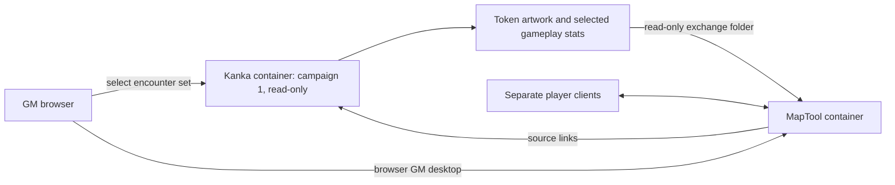

# MapTool encounter integration with local Kanka

Status: **retired proposal**, 2026-11-06. The MapTool demo was shut down and its deployment files/resources removed at the user's request. Private profile snapshots remain in ignored storage. This document preserves the encounter-only scope for evaluating another VTT; the steps and estimates below are historical, not an active deployment plan. Kanka is unchanged.

## Scope and source

Use **[5e Rules — SRD 5.1, campaign 1](http://127.0.0.1:18081/w/1)** as the read-only source for encounter token sets. Kanka retains all lore, rules text, notes, journals, quests, timelines and reference browsing. MapTool receives only the artwork and gameplay statistics needed for explicitly selected participants in an encounter, plus links back to their Kanka entries.

Do not copy the whole SRD into MapTool. Do not export handouts, descriptions, spell libraries, rule cards, notes or timelines. Do not add encounter records or bookkeeping properties to campaign 1. Store encounter configurations, export manifests and mappings separately in private application storage. The existing active working campaign is unchanged; selecting campaign 1 as this integration's source does not switch or modify Renovar.

The [local/live sync arrangements](../sync.md) still govern identity, permissions and edition separation. This local encounter workflow performs no live Kanka sync and has no writeback path into the SRD.

| Responsibility | Kanka | MapTool |
| --- | --- | --- |
| Lore, rules, notes and campaign records | Remain here and are read here | Source links only |
| Creature/NPC templates | Read selected 2014 SRD entries from campaign 1 | Selected token image and gameplay fields |
| Encounter composition | Private integration configuration: participants, counts and source IDs | Create the requested token instances |
| Combat | Source reference when needed | Position, initiative, current HP, temporary conditions and rolls |
| Results and campaign changes | Updated manually by the user outside this integration | Save encounter state locally; no automatic return transfer |

Example only: selecting four Kobolds and one Bandit exports two templates and creates five separate tokens. It does not export every humanoid, create five new Kanka creatures or assign the encounter to Renovar's story.

## Container design

Add one `maptool` service to the existing Compose stack. Keep bundle generation in the existing Kanka app and worker. No bridge daemon, network polling or direct database connection from MapTool is needed.

MapTool is a desktop application with an integrated game server. Run it on a virtual display inside its container and expose the GM desktop through Xpra HTML5. Players use separate MapTool clients; a shared GM desktop is not an independent player session. [MapTool overview](https://www.rptools.net/toolbox/maptool/), [Xpra HTML5](https://github.com/Xpra-org/xpra-html5).

| Component | Proposed arrangement |
| --- | --- |
| Kanka | Existing `http://127.0.0.1:18081/w/1`; retain existing runtime services. |
| MapTool GM desktop | Proposed `http://127.0.0.1:18082`, authenticated Xpra HTML5, loopback binding. |
| Game connection | Configure a dedicated port, provisionally `51234`; local testing first. LAN/VPN access requires an explicit reachable bind and matching link origins. |
| MapTool data | Named volumes for its user profile and saved campaigns, separate from installation files. |
| Encounter outbox | Ignored `storage/app/maptool/outbox/`, mounted read-only at `/exchange/outbox` in MapTool. |
| Private configuration | Ignored `storage/app/maptool/encounters/` and `mappings/`; no source-record changes. |

Use a pinned official self-contained MapTool Linux archive, compatible Xpra/HTML5 packages and software rendering. Start with the previously inspected **1.18.7** release and verify graphics, input and bundled dependencies before pinning the tested image. Its release notes describe the Linux archive and Ubuntu 24.04 dependency baseline. [Release details](https://github.com/RPTools/maptool/releases/tag/1.18.7).

MapTool starts with normal Compose startup once implemented. Kanka remains usable if MapTool is stopped. A successful desktop health check does not prove the game server is ready or the campaign has been saved. Allow roughly 2–3 GiB additional memory initially, then measure a representative encounter; this is a planning allowance, not a benchmark.

## Encounter selection and export

Add a small campaign-scoped **Encounter tokens** page, initially targeting campaign 1. Proposed route: `/w/{campaign}/integrations/maptool/encounters`. The GM selects creature/NPC entries, counts, token labels and available images. Show a preview of exactly which fields and assets will be transferred, with missing or unsupported fields clearly marked.

Use a versioned JSON bundle containing only:

- Encounter ID, batch ID, source installation UUID, source campaign ID and template entity IDs.
- SRD key, 2014 rules edition, source hash and export-field hash for each selected template.
- Display name, token image, size and approved numeric or categorical combat fields.
- Requested counts and stable, unique token instance IDs.
- Browser links to the matching campaign 1 entries and required asset attribution.

Build each selected template once. Package only its chosen image, with a checksum and credit, so combat does not depend on temporary image URLs. Do not recursively fetch linked entries, copy descriptions or mount the MinIO bucket into MapTool. There is no inbox or session-results importer.

Check campaign and entity permissions when building the bundle and serving it. The Kanka UI runs under the user's normal authenticated session. MapTool imports the curated local bundle, so it needs no owner PAT, Kanka login, database password or online token.

### Gameplay fields

| Field group | Allowed content |
| --- | --- |
| Identity | Name, size, creature type, source URL and token artwork |
| Basic combat | AC, maximum HP, hit-dice formula, movement, six ability scores/modifiers and initiative modifier |
| Defenses and perception | Recorded saves, skills, senses, passive Perception and resistance/immunity/vulnerability labels |
| Attacks and limited actions | Names, to-hit bonuses, reach/range, damage dice/types, save DCs, uses and recharge values only when verified for this encounter |
| Runtime state | Per-instance current HP, initiative, position, temporary effects and expended uses maintained by MapTool |

Keep full ability, spell and rules explanations in Kanka. Action names and mechanical parameters may travel; their prose descriptions do not. A source link opens the authoritative details in Kanka when needed.

The prepared creature records already contain fields such as `armor_class`, `hit_points`, `speed`, `saving_throws`, `skills`, `senses`, `STR` through `CHA`, and modifiers. Some values combine numbers and explanatory text, such as an HP average with its dice formula. Validate conversions and retain the original field value in the export preview; do not silently discard qualifiers. Attacks are not consistently exposed as structured properties, so the first version supports manually checked encounter attack fields rather than promising a universal stat-block parser.

Unknown values stay blank and are reported. Do not infer complete PC statistics from a race or class template. Campaign 1 contains SRD creatures and generic NPCs, not Lux's current campaign character sheet. A future custom-party source would require explicitly selecting another campaign and is outside this plan.

### Import and refresh

Use a minimal fixed MapTool add-on with import/update macros and a token property namespace owned by this integration. Validate the `.mtlib` format against the chosen release; RPTools documents packaged add-on libraries. [Add-on documentation](https://docs.rptools.info/blog/add-on-libraries/).

Prove bundle ingestion and image handling first. If direct file reading is unsuitable, begin with GM-pasted JSON and manual image selection from the mounted outbox. Generate tokens from a known-good MapTool template; avoid hand-writing native campaign/token XML without a verified fixture.

The first version supplies token properties and simple initiative, attack and damage roll buttons where values are available. It does not implement automatic spell effects, condition resolution, character advancement or a full third-party 5e framework.

Importing the same encounter twice must reuse its instance mappings, not spawn duplicate tokens. A new encounter or an explicit additional spawn gets new instance IDs. For new creature instances, initialize current HP from the selected maximum; refreshing existing tokens preserves current HP, position, initiative and expended uses. Any deliberate reset must be explicit. Preview changed template fields before applying a refresh and leave local overrides unresolved rather than overwriting them.

Maintain separate source and instance identities: five tokens can point to one Kanka creature entry. Use SRD keys and scoped entity mappings rather than fuzzy names. Existing 5e matching and edition guards remain applicable, without importing another reference library into MapTool.

## Reading Kanka while playing

Keep Kanka open in a separate browser tab. Provide the source link on each imported token or its small stats panel, plus source links on the encounter-selection page. Do not build a lore browser or duplicate a journal sidebar in MapTool.

Browser URLs use `http://127.0.0.1:18081/w/1/entities/{id}` for the local GM. Other workstations need a configured LAN/VPN hostname; their own loopback address cannot reach the host. A container-side hyperlink launcher may not open a tab in the workstation browser, so retain a copyable link and test optional Xpra link forwarding before promising one-click host-browser navigation.

No network refresh service is included. Regenerate the encounter bundle in Kanka and run a manual import/update when the selected templates change. Add direct API fetch only if a later need justifies it.

## Implementation steps and estimates

| Step | Deliverable | Estimated effort |
| --- | --- | --- |
| 1 | MapTool container, GM desktop, persistent campaign, separate player connection and restart/save check | 3–5 hours |
| 2 | Campaign 1 encounter selector, field allowlist, validation preview and selected image/JSON export | 3–5 hours |
| 3 | Minimal add-on, token creation, basic rolls and duplicate-safe manual refresh | 4–7 hours |
| 4 | Encounter pilot, privacy checks, backup/restore and launch instructions | 2–3 hours |
| **Total** | **Usable encounter-only integration** | **12–20 hours, roughly 2–3 working days** |

This estimate assumes container graphics and MapTool bundle import work as expected. Complex action parsing, complete character-sheet conversion, a combat framework or browser-per-player hosting would require a separate scope.

Pilot using a few verified 2014 SRD creatures from campaign 1, including repeated instances of one template. Use a disposable MapTool scene or manually supplied existing battle map. Map generation, Kanka map-marker conversion and broad asset import are excluded.

## Verification and operations

Verify these outcomes before considering the integration ready:

1. Both applications run in containers, the GM desktop works, and a separate player client can join without GM desktop access.
2. Only selected templates, counts, images and allowlisted gameplay fields appear in the bundle. Lore, rules prose, notes and unrelated linked resources are absent.
3. AC, HP/dice, abilities, movement and any supported attacks match the selected Kanka values; missing values remain visible as missing.
4. Multiple tokens have independent HP/state. Re-importing a set creates no duplicates and does not heal, move or reset existing tokens.
5. Source links point to the matching campaign 1 entities. No online Kanka request is made.
6. Campaign 1 records, properties, relationships, source hashes and artwork associations remain unchanged. Encounter bookkeeping stays outside the campaign entities.
7. No credentials or private campaign material are embedded in bundles, macros, token properties or saved player files. Verify how player clients receive NPC statistics; hiding fields visually is insufficient. If field-level confidentiality cannot be guaranteed, keep sensitive details in Kanka and export only player-safe mechanics.
8. Saving/restarting MapTool preserves its encounter. Backups cover its saved campaign/profile volumes and mappings in addition to existing Kanka backups; restore a disposable encounter to verify the process.

Preserve source attribution and existing license notices for MapTool, its desktop components, stat data and artwork. Keep all runtime bundles, credentials and campaign files ignored by Git and Docker build contexts. Disabling the integration should stop MapTool and remove its navigation link while retaining saved volumes; no campaign data rollback is required.

There is no automatic transfer back to Kanka, no loot/quest/journal/timeline importer, no live Kanka synchronization, no full SRD compendium inside MapTool and no full 5e rules engine in this reduced scope.
