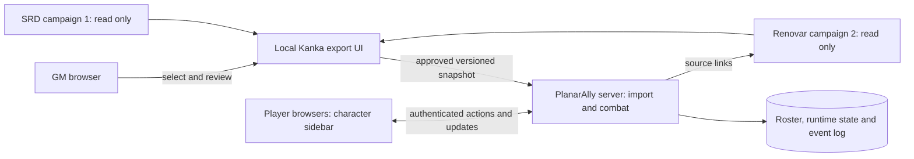

# Kanka–PlanarAlly 5e combat integration

Status: proposed implementation plan, 2026-11-06. The standalone demo is running; the integration described here is not implemented. This plan supersedes the retired MapTool proposal for the player character workflow.

**Superseded integration direction:** the user subsequently selected a [GM-facing OCF handler with read-only Kanka and prepared DR launch](kanka-ocf-dungeon-revealer-plan.md). Retain this document as background; its PlanarAlly-specific architecture is not the current implementation proposal. The PlanarAlly demo remains available.

The subsequent [Cauldron and Dungeon Revealer assessment](vtt-combat-fit-assessment.md) recommends retaining PlanarAlly as the baseline, with Cauldron as a credible candidate for a short comparison spike before substantial implementation.

## Outcome and test source

The GM imports selected Kanka characters into a PlanarAlly room and makes them available to approved players. Players select their assigned character, see a combat sidebar, click abilities and attacks, and share dice rolls and combat interactions in a persistent session log.

Use **local Renovar, campaign 2**, at <http://127.0.0.1:18081/w/2> as the **read-only test source**, as explicitly requested. Use Lux as the first candidate if its available properties support the required mechanics, then a second character and a repeated enemy template. Missing mechanics require GM review rather than assumptions. Campaign 1, **5e Rules — SRD 5.1**, remains an unchanged, read-only rules reference. No hosted Kanka campaign is contacted.

Kanka remains authoritative for character build, equipment, rules, lore, notes and source artwork. PlanarAlly owns encounter HP, temporary HP, initiative, effects, spent resources, token position and session history. Neither application writes combat results back to Renovar or the SRD campaign. Import configuration, mappings and corrections live in separate integration storage, never in source character properties, notes, tags or relationships.

Target rules: **2014 5e / SRD 5.1**. A campaign-specific feature outside the SRD can be selected as a private, explicitly reviewed action; no 2024 mechanics are inferred or substituted. The base integration does not include non-SRD sourcebook text.

## Player and GM workflow

1. In Kanka, the GM opens a proposed **Combat export** page for local Renovar, selects characters, and chooses the destination PlanarAlly room. The page also supports explicitly selected enemies; it does not import the campaign wholesale.
2. The GM reviews a normalized sheet: detected statistics, equipped attacks, selected abilities/spells, artwork and missing or conflicting values. Any correction is an integration override with its original source value preserved. Each action is marked **ready**, **reference only**, or **needs review**.
3. The GM publishes the reviewed roster to the room and assigns each character to named PlanarAlly accounts. Optionally, the GM marks particular characters available to claim. Selecting a character does not grant ownership by itself: a claim must be permitted by the GM and committed atomically by the server.
4. Players sign in to their own PlanarAlly accounts, select from characters assigned to them or available to claim, and activate the matching token. The GM can transfer control. Multiple browser tabs for one account share that assignment; separate players cannot simultaneously claim an exclusive character.
5. Selecting a controlled token populates the combat sidebar. Selecting another player's token or an enemy shows only GM-approved public information. The sidebar has **Stats**, **Actions**, **Resources** and **Effects** sections, with source links back to Kanka.
6. A player clicks an attack, save, skill, initiative or supported ability. The sidebar shows the formula, available advantage/disadvantage and any explicit situational modifier before submitting. The server checks ownership and resolves the approved action, then publishes a structured result card to its permitted audience.
7. The GM confirms damage/healing or effects on targets when required. The log records the roll, confirmation and resulting state change as linked events. Refreshing a browser or restarting the container retains the session.

Proposed layout:

```text
┌──────────────────────┬─────────────────────────────┬──────────────────────┐
│ Character: Lux    ▾  │                             │ Session log          │
│ HP / temp HP / AC    │                             │ Lux → Longbow        │
│ Initiative / speed  │      Map and tokens         │ d20 roll + modifiers │
│ Stats | Actions     │                             │ Damage → GM confirm  │
│ Resources | Effects │                             │ HP/effect changes    │
│ [Attack] [Save] ...  │                             │ Public / GM filters  │
└──────────────────────┴─────────────────────────────┴──────────────────────┘
```

This is a UI target. The initial sidebar should be a resizable native panel; on smaller screens the sheet and log can alternate in one panel. Character selection and action buttons remain available without leaving the map. Full rules explanations open their Kanka source entries.

## Architecture and deployment

Use the existing Kanka application and worker for selection, normalization and export. Add a versioned combat module to a pinned PlanarAlly fork: a Vue sidebar and Python server handlers, permissions and persistent events. Reuse its map, assets, token controls and initiative features where appropriate. No extra bridge daemon, shared database or player Kanka PAT is needed.



The export path is a server-to-server request from Kanka to an internal PlanarAlly endpoint. Preserve separate Compose projects and volumes. Connect only necessary application/worker services and PlanarAlly through a dedicated private Docker network; do not expose Kanka's databases or grant PlanarAlly database access. Browser links use a configured reachable browser origin, not Docker service names.

The integration must be disabled by default for ordinary Kanka deployments. The current PlanarAlly demo remains usable without it. Installing a fork requires a separately tagged image and rollback to the current pinned image after backing up compatible data. Pin the upstream tag/commit, adapter schema and integration version together.

PlanarAlly mods are browser extensions, not server plugins. They can support custom sheet UI, but cannot supply authoritative server rolls, import authorization or persistent combat transactions by themselves. Its current public mod interface exposes shape settings tabs and context-menu extensions; a permanent combat sidebar is not established by those hooks. The recommended approach is a small maintained PlanarAlly fork, with a reusable mod only where the verified API fits. [Official mod documentation](https://planarally.com/docs/dm/mods/), [v2026.2 mod interface](https://github.com/Kruptein/PlanarAlly/blob/v2026.2/client/src/mods/models.ts).

## Import format and reference mapping

Use a versioned `CombatProfile` snapshot. Its stable identity includes installation UUID, source campaign ID and Kanka entity ID; retain the entity's child ID separately where native Kanka API routes need it. PlanarAlly room, combatant and token instance IDs are separate identifiers. Names are display labels, not identity keys.

| Group | Fields and import policy |
| --- | --- |
| Source | Installation/campaign/entity IDs, source URL, edition, source revision/hash, schema version and import timestamp |
| Identity | Character name, size, player-safe portrait/token, class levels and race labels where recorded |
| Defenses and movement | AC and qualifiers, max HP, hit dice, movement modes, senses, resistances, immunities and vulnerabilities |
| Core statistics | Six ability scores, proficiency bonus, initiative, saves, skills, expertise and passive scores |
| Attacks | Reviewed equipped weapon/action, attack bonus, reach/range, damage dice/type, additional damage choices and critical behavior |
| Abilities | Selected features and actions, activation type, uses/recharge, save DCs and Kanka reference links |
| Spellcasting | Recorded casting ability, attack bonus, DC, selected/prepared spell references, slots and limited-use casting resources |
| Resources | Reviewed maximum uses, spell slots, hit dice and named class resources; current values belong to combat state |
| Access | GM-approved player roster, approved public fields and permitted source links; never a copied Kanka credential |

Read Kanka character records, entity attributes, entity abilities, referenced ability records and selected inventory/item records. The inspected local API provides `campaigns.entities.attributes`, `campaigns.entities.entity_abilities`, `campaigns.entities.inventory`, character and ability resources. Kanka does not expose a ready-made 5e character sheet: normalize these records and present missing/conflicting values to the GM. A race/class link alone is insufficient to calculate a complete PC.

Never infer equipped attacks from every inventory item. Preserve equipment quantities, relevant proficiency, damage choices and source qualifiers. Support multiclass level totals and recorded overrides without blindly adding a proficiency or fighting-style bonus twice. Validate ordinary derivations; prefer an explicitly reviewed sheet value when a feature changes the normal formula. Do not attempt universal prose/PDF parsing in this iteration.

Follow only selected ability/item/spell references needed by the imported combatants. Match canonical 5e references using the existing `sync.md` rules and explicit identities; retain approved campaign variants. Do not create or deduplicate Kanka entries during combat export. The sidebar carries action names, approved mechanical parameters and source links; full lore, private journals and rule libraries remain in Kanka. Any short ability summary must be explicitly selected for the player audience.

Cache only selected artwork with a checksum, original source and attribution. Use a generic token when no appropriate approved image is available. All private campaign snapshots and artwork remain ignored runtime data; never place them in public repository seeds.

### Refresh and state ownership

Repeatedly importing the same source into the same roster updates its reviewed profile rather than creating a second character. Spawning multiple enemies creates independent combatant/token instances from one profile. PC resource state follows its combatant across scene/token changes; creating a second token must not duplicate slots or uses.

Manual refresh presents a field-level diff. Changed source fields do not silently overwrite explicit GM overrides. Refresh preserves current HP, temporary HP, expended resources, conditions, initiative and position. If max HP or resource limits change, ask the GM how to reconcile affected current values; do not silently heal or reset them. New sessions inherit or reset state only through an explicit reviewed operation. Store import and override hashes independently so changes are explainable and duplicate-safe.

## 5e combat behavior

Implement a small explicit rules layer rather than a complete character builder or automated referee.

| Initial behavior | Handling |
| --- | --- |
| Checks, saves and initiative | Approved formula and modifiers; advantage/disadvantage where applicable; initiative enters the existing tracker |
| Weapon and spell attacks | Attack and damage are distinct linked rolls; record natural die separately from total; offer critical damage dice without doubling flat modifiers |
| Ability and skill math | Ability modifiers, proficiency/expertise and explicit overrides; show the derivation for GM review |
| HP and healing | Current/max/temp HP with server validation; damage type and resistance/immunity/vulnerability adjustments previewed for GM confirmation |
| Limited resources | Declared use/slot consumption linked to the action; retries do not spend twice; cancellation/correction is recorded |
| Conditions and concentration | Track labels, duration/round references and concentration state; reminders and manual confirmations initially |
| Turn flow | Initiative order, round/turn transitions, action/bonus-action/reaction use as visible bookkeeping with GM override |
| Rests | GM-confirmed reset preview for resources whose recovery rules are explicitly supported; unsupported rules remain manual |

Advantage and disadvantage cancel according to the selected 2014 rules; extra sources do not stack dice. Attack critical rules do not automatically apply to ordinary checks or saves. Reject invalid or unbounded dice expressions; resolve supported formulas with a small parser and server-side randomness, never executable macros or `eval`. Conditional damage, feature interactions, concentration saves, death saves and complex spell targeting can start as explicit roll buttons plus manual adjudication. Movement distance and line of sight can be displayed without claiming automatic legality checks.

Automatic spell-effect resolution, character leveling, all multiclass interactions, opportunity-attack detection and full rules enforcement are later work. A reference-only ability remains visible with its source link and a manual-use log button; the interface must not invent unsupported mechanics.

## Persistent roll and interaction log

Add a durable server-side event store scoped to PlanarAlly room and session. The inspected v2026.2 chat and dice handlers relay incoming results; they do not create durable combat history or authoritatively calculate submitted results. The current chat accepts a supplied author, so the new combat log must derive actor identity from the authenticated server session. [Dice handler](https://github.com/Kruptein/PlanarAlly/blob/v2026.2/server/src/api/socket/dice.py), [chat handler](https://github.com/Kruptein/PlanarAlly/blob/v2026.2/server/src/api/socket/chat.py).

Record:

- Server event ID, ordered session sequence, timestamp, authenticated actor and acting combatant.
- Action/profile version, approved formula, situational inputs, individual die results, total and linked target/event IDs.
- Visibility: public, actor-and-GM, or GM-only; player requests for broader visibility cannot override GM policy.
- Confirmed HP/resource/effect changes, initiative/turn changes, and before/after values where the audience may see them.
- GM corrections, undo operations and rerolls as new linked events, preserving the original event.

The server receives an action request, not a browser-calculated roll total. Validate room membership, character control, selected action, target permissions, resource availability and expected state revision. Commit the event and state changes in one transaction, then publish the authorized result. Use request IDs for deduplication, optimistic state versions for competing updates, and a recoverable event delivery/outbox mechanism. Reconnecting clients resume from their last sequence without rerolling or reapplying damage.

Render readable cards with character portrait/name, action, dice breakdown, target and permitted outcome, plus buttons for damage or follow-up saves where supported. NPC AC, true HP and secret bonuses must not leak through public comparisons, totals, error messages or event payloads. A player can see their attack total while the GM sees the private defense comparison. Do not log every mouse drag: log explicit combat interactions and optional finalized movement, with movement history disabled by default to keep the log readable.

Support session filters and authorized JSON/text export. Keep snapshots, events and assets in backup coverage. Existing PlanarAlly campaign export alone is insufficient as a backup contract for new integration state and optional mods; verify a full restore including those files and database tables.

## Permissions and implementation constraints

The Kanka export page requires an authenticated authorized campaign user and the configured integration-GM role. Use campaign/entity ACL-scoped reads and child-record visibility checks, then a separate deliberate review of what will be shared with PlanarAlly players. GM access to a private note does not make that note exportable by default.

Pair the Kanka export installation with specific PlanarAlly rooms through a GM-approved setup. The internal import endpoint accepts authenticated, integrity-protected requests scoped to approved installation/room pairs, with expiration and replay protection. Keep pairing secrets server-side and outside Git, browser payloads and ordinary logs. PlanarAlly players never receive a Kanka owner token. No endpoint in this workflow writes to the source campaigns.

Apply permissions and recipient filtering on the server before every mutation and broadcast. The inspected native movement handler checks ownership before persisting a move but subsequently broadcasts the submitted movement list; our earlier demo verified persisted state, not all unauthorized broadcast behavior. Before multiplayer acceptance, test and correct unauthorized movement broadcasts as needed, plus native tracker, character, custom-data and initiative paths that could bypass the combat module. A protected sidebar is insufficient if a raw Socket.IO request can mutate or expose the same state.

Document which native controls remain allowed and route protected HP/resource mutations through the authoritative combat service. The imported base profile is GM-controlled; players can use granted actions and edit permitted runtime fields. Hiding an enemy's information in the browser is not permission enforcement. Test redaction against raw network payloads and all secondary character/token views.

Both applications retain their own logins. Automatic account linking and single sign-on are outside the initial scope. LAN/VPN play requires configured reachable URLs and access controls; a remote player's `127.0.0.1` does not reach this host.

## Phases and estimates

These are engineering effort estimates for a limited usable 5e combat integration, not elapsed-time guarantees. They assume one developer, the running demo and local Kanka fork, and a small private group.

| Phase | Reviewable deliverable | Effort |
| --- | --- | --- |
| 1. Compatibility and data audit | Read-only Renovar field audit, synthetic sidebar/roll prototype, versioned schema and permission/bypass checks | 4–8 hours |
| 2. GM import and roster | Kanka selector, normalization/review, private snapshots, artwork, room pairing, repeat-safe imports and player assignment | 8–12 hours |
| 3. Player combat sidebar | Character selector, stats/actions/resources/effects, token linkage, public/private views and source links | 10–16 hours |
| 4. Authoritative combat and log | Supported 2014 formulas, server rolls, confirmed effects/resources, durable audience-filtered events and reconnect replay | 12–20 hours |
| 5. Pilot and operations | Lux/second-PC/enemy trial, refresh/concurrency/privacy tests, backup/restore, Docker build and handoff | 6–10 hours |
| **Total** | **Limited combat integration ready for a private-group pilot** | **40–66 hours, roughly 5–9 working days** |

A first vertical slice should follow phases 1–2 and part of phase 3: one reviewed character, one assigned player, HP/AC, one attack, a server-generated roll and a persistent result card. Keep this slice functional before broadening the supported sheet. If the Renovar sheet lacks structured mechanics, scope the first slice to GM-confirmed fields rather than delaying it for a general parser. Expand ability/spell automation only after the pilot.

## Acceptance checks

1. Import two selected Renovar characters and an enemy template without changing Renovar or campaign 1. Compare source record/property/relation hashes before and after; no online Kanka traffic occurs.
2. A player selects only assigned/claimable characters. Concurrent exclusive claims resolve to one owner; raw requests for another character or room fail without state changes or unauthorized broadcasts.
3. Imported AC, HP, scores, proficiency, equipment attacks and selected actions match the GM review. Missing/ambiguous mechanics remain visibly unresolved. A private journal or unselected relationship never appears in the snapshot.
4. The sidebar changes with the controlled character. GM-only enemy HP/AC/abilities are absent from player API responses, Socket.IO events, exports and logs.
5. Verify representative 2014 formulas: advantage/disadvantage cancellation, natural die versus total, expertise, ranged/melee damage choices, critical dice, temporary HP and explicitly supported resource recovery. Cross-check the selected rules against the local SRD; do not silently automate unsupported features.
6. Duplicate action requests, retries and reconnects neither reroll nor spend/apply twice. Simultaneous changes cannot lose HP/resource updates. Client-forged totals, actor names, action definitions and secret visibility requests are rejected.
7. Reimporting creates no duplicate PC/token mappings and preserves combat state. Two instances of one enemy have independent HP; multiple tokens representing one PC share the intended resources.
8. Public, actor-and-GM and GM-only histories survive page reload/container restart and retain correct audiences. Corrections and rerolls remain traceable. Kanka and PlanarAlly remain usable when the other service stops; approved snapshots can continue a running encounter offline from Kanka.
9. Restore the PlanarAlly database, integration mappings, selected assets, log and exact image/module version into a disposable environment. Confirm roster ownership and event replay before calling the pilot ready.

## Proposed repository changes

Keep the Kanka selection/normalization implementation and integration contract in this fork, following its existing Laravel ACL, service, queue and Sail patterns. Keep the PlanarAlly server/client changes in a separate source fork with pinned build metadata; do not intermingle the two applications' license files. Preserve Kanka's existing terms and PlanarAlly's MIT notices. Retain SRD attribution and selected artwork notices. Private Renovar data is never part of either public repository or published image.

Likely areas: a campaign-scoped export controller/policy and review view; profile normalizer/validator; pairing/export client and private import mappings; a PlanarAlly combat service, schema migrations, authenticated routes/events, sidebar and log components; contract fixtures with synthetic characters; focused integration and browser tests. Exact file/class names should be chosen after the compatibility spike.

See [demo operations](planarally-demo.md), [sync arrangements](../sync.md), and the [upstream example mods](https://github.com/Kruptein/planarally-mods). That repository illustrates character sheets and DataBlocks but should be verified against the pinned release rather than treated as a ready-made 5e combat system.
